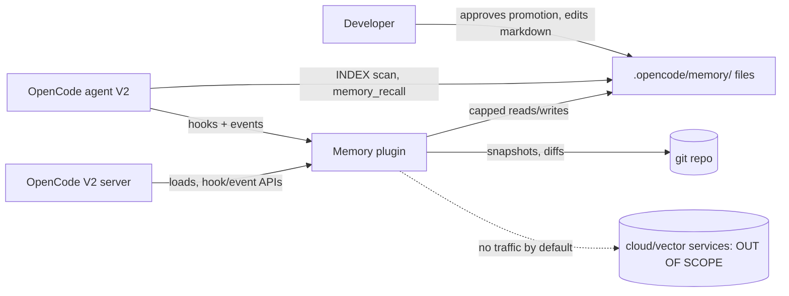

# C4 Level 1 — System Context: No-Fuss Memory Plugin for OpenCode V2

**Status:** proposed. **Sources:** Synthesized Report §§1–4; V2 instructions docs (AGENTS.md hierarchy); upstream privacy practice (per-project scoping).

## System boundary

Inside: the memory plugin (`.opencode/plugins/memory/`) plus the memory file store (`.opencode/memory/`). Everything else is external.

## Actors and external systems

| Actor / system | Relation to the plugin |
|---|---|
| Developer | Owns durable memory; approves promotion via `/memory-review`; reads/edits markdown directly in git |
| OpenCode agent (V2) | Reads `INDEX.md` (content via deduped `prompt` hook; protocol+links via `AGENTS.md` only), calls `memory_recall`, follows the `AGENTS.md` memory protocol |
| OpenCode V2 server/runtime | Loads the plugin (`plugins` key / `.opencode/plugins/` discovery); provides hooks, events, transforms, `ctx.storage`, `ctx.vcs` (event names verified at P1 — see `c4-03-components.md` event-note) |
| Local filesystem + git | Durable store and ultimate backbone: history, blame, undo/redo, restore |
| GitHub issues | Manual source for `issues.md` lines (todo/doing/done), validated by `/memory-review`. No API dependency |

## Explicitly outside the boundary (non-goals)

Cloud memory services, vector databases, embedding providers/models, team/sync servers, knowledge graphs, background LLM consolidation ("dreaming"). Rationale: Report §3 (cloud fatigue, vector support load, opaque stores) and §4.8 (determinism over fuzzy recall).

## Context diagram

## Privacy boundary

Local-only by default; strict per-project scope (no cross-project reads); secrets/`.env` blocklist plus `<private>` redaction; memory files are untrusted input (size-capped, never executed).
