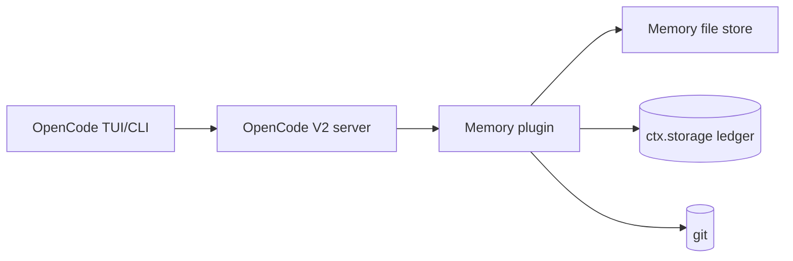

# C4 Level 2 — Containers / HLD: No-Fuss Memory Plugin for OpenCode V2

**Status:** proposed. **Sources:** Synthesized Report §4; V2 docs `/v2/docs/plugins/`, `/v2/docs/build/plugins/`, `/v2/docs/config/`. **Normative on V2 contracts:** `design-spec-v2-production.md`.

## Containers (all local, single machine)

| Container | Role |
|---|---|
| OpenCode TUI/CLI | Developer surface; runs `/memory-review`, shows notices |
| OpenCode V2 server + plugin runtime | Loads plugin from `plugins` array or `.opencode/plugins/` auto-discovery; exposes `session.hook`, `tool.hook`, `event.subscribe`, `tool`/`command` transforms, `storage`, `vcs` |
| Memory file store | Six markdown files (`INDEX/activeContext/decisions/architecture/style/issues`) + `handoffs/` under the fixed directory `.opencode/memory/` (see `c4-05-data-model.md`; `handoffs/` root = session snapshots, `handoffs/archive/` = retired durable lines) |
| Capture ledger | Durable JSON in `ctx.storage` (`seen/<id>`, `attempt/<id>`, `curation.pending`, `curation.rotated`) — restart-safe idempotency |
| `memory-manager` sandbox | Read-only subagent (`edit` deny, `shell` deny) that reads memory and emits a provenance-tagged proposal table; it cannot act on what it reads (ADR-0007) |
| Git repository | History, blame, restore; branch/status source for handoff snapshots |
| FTS mirror (deferred P2 opt-in only) | Read-only derived index, never source of truth; off by default per ADR-0001 |

## Topology and data flow

Single machine, zero network calls in the default path. Flow: prompt admission → INDEX attach (`prompt` hook, sole `INDEX.md` content injector, deduped) → work with failure-only capture (`tool.hook("execute.after")` → provenance-tagged `source:tool` summary + recall-only detail in the scratchpad; an explicit user directive is `source:user` and appends straight to `decisions.md`) → brief (summary lines only) + status line + hint at bottom (`context` hook; root AGENTS.md carries protocol+links only, never content) → content-hash-guarded idle snapshot (`handoffs/YYYY-MM-DD-HHmm.md`; same content → no-op; newest wins) → priors into summary (`compaction` hook, priors only — never sets `event.result`) → human-approved promotion (`/memory-review` runs read-only in the `memory-manager` sandbox, returns a proposal table, resets the status counters).

## Cross-cutting concerns

- **Budgets:** `INDEX.md` ≤30 lines on disk; `activeContext/architecture/style/issues` ≤60 lines on disk; `decisions.md` unbounded on disk with ≤60-line injectable tail (full log + git retains everything); handoffs per-file ≤60 lines; auto-inject payload (prompt `INDEX.md` attach + context brief + status line + hint) ≤~80 lines (`INDEX ≤30 + brief ≤48 + status ≤1 + hint ≤1`) (~1.5k tokens, excludes static `AGENTS.md` directive ~10 lines + tool description ~3 lines). Content overflow (retired lines, rotated scratchpad blocks) → `handoffs/archive/`; session snapshots → `handoffs/` root; never the prompt. The status line carries the rotation notice and review-due nudge so uncurated memory never goes silent.
- **Cost/latency:** $0 default; file reads only.
- **Permissions:** `memory-manager` subagent is **read-only** — `edit * → deny`, `shell * → deny` (ADR-0007); it proposes and never writes, so application of approved lines happens outside it. Primary agents unchanged.
- **Security:** secrets blocklist, `<private>` redaction, per-project isolation, size caps before inject. Memory content is **untrusted data, never instructions**: raw captured output is never auto-injected (summary line only), and untrusted candidates are never bulk-approved (ADR-0007).
- **Config:** `.opencode/opencode.jsonc` → `plugins: ["./plugins/memory"]`; repo-root `opencode.jsonc` → `plugins: ["./.opencode/plugins/memory"]`; plus `agents: { memory-manager }`. Memory location is fixed at `.opencode/memory` (ADR-0006) and no `references` entry is registered (references attach directories and are client-initiated). V2 `instructions` array is accepted but not resolved — memory rides root `AGENTS.md` + `prompt` hook, never `instructions`.
