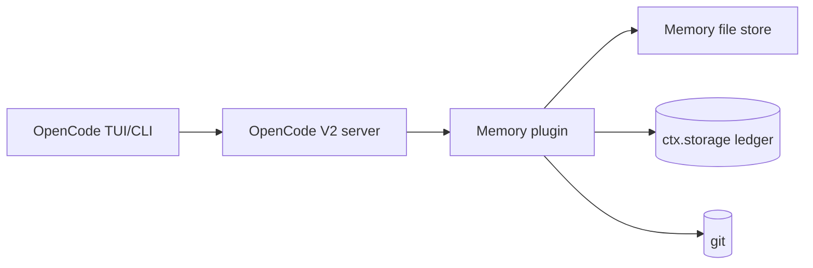

# C4 Level 2 — Containers / HLD: No-Fuss Memory Plugin for OpenCode V2

**Status:** proposed. **Sources:** Synthesized Report §4; V2 docs `/v2/docs/plugins/`, `/v2/docs/build/plugins/`, `/v2/docs/config/`. **Normative on V2 contracts:** `design-spec-v2-production.md`.

## Containers (all local, single machine)

| Container | Role |
|---|---|
| OpenCode TUI/CLI | Developer surface; runs `/memory-review` and prompts for per-line approval; the `[memory]` status notice is model-facing and relayed by the agent |
| OpenCode V2 server + plugin runtime | Loads plugin from `plugins` array or `.opencode/plugins/` auto-discovery; exposes `session.hook`, `tool.hook`, `event.subscribe`, `tool`/`command` transforms, `storage`, `vcs` |
| Memory file store | Six markdown files (`INDEX/activeContext/decisions/architecture/style/issues`) + `handoffs/` under the fixed directory `.opencode/memory/` (see `c4-05-data-model.md`; `handoffs/` root = session snapshots, `handoffs/archive/` = retired durable lines) |
| Capture ledger | Durable JSON in `ctx.storage` (`<projectID>/seen/<id>`, `<projectID>/attempt/<id>`, `<projectID>/curation.pending` (scratchpad-only), `<projectID>/curation.rotated`, `<projectID>/snapshot/<sessionID>`, `<projectID>/snapshotThrottle/<sessionID>`, `<projectID>/hint/<sessionID>/<promptHash>`; `ctx.storage` is plugin-scoped) — restart-safe idempotency with a single-flight (no CAS in the API) |
| `memory-manager` (optional) | Read-only subagent (`edit`/`shell`/`webfetch`/`websearch`/`skill` deny) that reads memory and emits a provenance-tagged proposal table; it cannot act on what it reads (ADR-0007). Optional **isolated venue** for the review — a child session keeps poisoned text out of the user's transcript. The default review runs in-session and writes nothing; there is **no** session permission lock (retired G5) |
| Git repository | History, blame, restore; branch/status source for handoff snapshots |
| FTS mirror (deferred P2 opt-in only) | Read-only derived index, never source of truth; off by default per ADR-0001 |

## Topology and data flow

Single machine, zero network calls in the default path. Flow: prompt admission → INDEX attach (`prompt` hook async/never-throw, sole `INDEX.md` content injector, deduped; also the site of the one `source:user` append to `decisions.md`, no pending increment) → work with failure-only capture (`tool.hook("execute.after")` → message-derived `source:tool` summary + optional recall-only detail in the scratchpad) → brief (message-derived summary lines, max 5; never INDEX/tail) + status line + hint at bottom (`context` hook, async/never-throw; root AGENTS.md carries protocol+links only, never content) → content-hash-guarded idle snapshot (`session.idle`, `handoffs/YYYY-MM-DD-HHmmss-<session6>ss-<session6>.md`; branch via `vcs.get()`, changes via `vcs.status()`; same content → no-op; newest wins; events filtered via `event.location`) → priors (activeContext + decisions tail + handoff) into summary (`compaction` hook, priors only — never sets `event.result`; produced summary captured from `compaction.ended` text+recent) → human-approved promotion (`/memory-review` writes nothing and returns a proposal table; the `memory_apply` tool approves one line per `ctx.permission.assert` and writes via `writeCapped`; `memory_apply` resets the status counters).

## Cross-cutting concerns

- **Budgets:** `INDEX.md` ≤30 lines on disk; `activeContext/architecture/style/issues` ≤60 lines on disk; `decisions.md` unbounded on disk with ≤60-line injectable tail via `loadPriors` + recall only (never the per-call brief; full log + git retains everything); handoffs per-file ≤60 lines; auto-inject payload (`INDEX ≤30 + brief ≤48 incl. max 5 error lines + status ≤1 + hint ≤1`) (~1.5k tokens, excludes static `AGENTS.md` directive ~10 lines + tool description ~3 lines). `INDEX` attaches **once per prompt**; the brief/hint/status are re-emitted **per model call** (the `context` hook runs on every model call including tool-driven continuations), so session-total cost is per-prompt × model steps; the hint is throttled via `<projectID>/hint/<sessionID>/<promptHash>`. Content overflow (retired lines, rotated scratchpad blocks) → `handoffs/archive/`; session snapshots → `handoffs/` root; never the prompt. The status line carries the rotation notice and review-due nudge (≥5 uncurated scratchpad captures) so uncurated memory is surfaced — but it is **model-facing** (`event.system`), so delivery depends on the agent relaying it.
- **Cost/latency:** $0 default; file reads only.
- **Permissions:** `memory-manager` subagent is **read-only** — `edit`/`shell`/`webfetch`/`websearch`/`skill` all `* → deny` (ADR-0007); it proposes and never writes, so application of approved lines happens outside it, through the plugin's `memory_apply` tool (`ctx.permission.assert` per line + `writeCapped`). The **default/primary** agent needs a `subagent` allow for `memory-manager` **only** if the optional delegation path is enabled. There is **no** session permission lock: the review only proposes and every write is per-line approved (retired G5).
- **Security:** secrets blocklist, `<private>` redaction, per-project isolation (root resolved per session from `event.location`; foreign events dropped), size caps before inject. Memory content is **untrusted data, never instructions**: raw captured output is never auto-injected (message-derived summary only), and untrusted candidates are never bulk-approved — `memory_apply` approves one line per `ctx.permission.assert` (ADR-0007).
- **Config:** `.opencode/opencode.jsonc` → `plugins: ["./plugins/memory"]`; repo-root `opencode.jsonc` → `plugins: ["./.opencode/plugins/memory"]`; plus `agents: { memory-manager }`. Memory location is fixed at `.opencode/memory` (read-path choke point + recall allowlist, ADR-0006) and no `references` entry is registered (references attach directories and are client-initiated). V2 **does** resolve the `instructions` array, but the design routes memory through root `AGENTS.md` + the `prompt`/`context` hooks instead — a deliberate single-owner choice, not a platform limitation.
