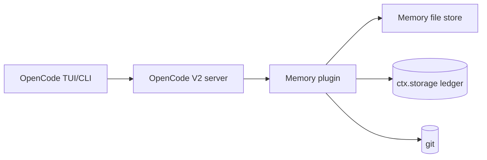

# C4 Level 2 — Containers / HLD: No-Fuss Memory Plugin for OpenCode V2

**Status:** proposed. **Sources:** Synthesized Report §4; V2 docs `/v2/docs/plugins/`, `/v2/docs/build/plugins/`, `/v2/docs/config/`.

## Containers (all local, single machine)

| Container | Role |
|---|---|
| OpenCode TUI/CLI | Developer surface; runs `/memory-review`, shows notices |
| OpenCode V2 server + plugin runtime | Loads plugin from `plugins` array or `.opencode/plugins/` auto-discovery; exposes `session.hook`, `event.subscribe`, `tool`/`command` transforms, `storage`, `vcs` |
| Memory file store | Six markdown files (`INDEX/activeContext/decisions/architecture/style/issues`) + `handoffs/` under `.opencode/memory/` (see `c4-05-data-model.md`; `handoffs/` root = session snapshots, `handoffs/archive/` = retired durable lines) |
| Capture ledger | Durable JSON in `ctx.storage` (seen IDs, attempt timestamps) — restart-safe idempotency |
| Git repository | History, blame, restore; branch/status source for handoff snapshots |
| FTS mirror (deferred P2 opt-in only) | Read-only derived index, never source of truth; off by default per ADR-0001 |

## Topology and data flow

Single machine, zero network calls in the default path. Flow: prompt admission → INDEX attach (`prompt` hook, sole `INDEX.md` content injector, deduped) → work with failure-only capture (event stream → scratchpad) → brief + hint at bottom (`context` hook; root AGENTS.md carries protocol+links only, never content) → content-hash-guarded idle snapshot (`handoffs/YYYY-MM-DD-HHmm.md`; same content → no-op; newest wins) → priors into summary (`compaction` hook, shape-guarded) → human-approved promotion (`/memory-review`).

## Cross-cutting concerns

- **Budgets:** `INDEX.md` ≤30 lines on disk; `activeContext/architecture/style/issues` ≤60 lines on disk; `decisions.md` unbounded on disk with ≤60-line injectable tail (full log + git retains everything); handoffs per-file ≤60 lines; auto-inject payload (prompt `INDEX.md` attach + context brief + hint) ≤~80 lines (~1.5k tokens, excludes static `AGENTS.md` directive ~10 lines + tool description ~3 lines). Content overflow (retired lines, rotated scratchpad blocks) → `handoffs/archive/`; session snapshots → `handoffs/` root; never the prompt.
- **Cost/latency:** $0 default; file reads only.
- **Permissions:** `memory-manager` subagent edits scoped to `.opencode/memory/**`, shell denied; primary agents unchanged.
- **Security:** secrets blocklist, `<private>` redaction, per-project isolation, size caps before inject.
- **Config:** `.opencode/opencode.jsonc` → `plugins: ["./plugins/memory"]`; repo-root `opencode.jsonc` → `plugins: ["./.opencode/plugins/memory"]`; plus `agents: { memory-manager }`, `references: { memory }` where `references.memory = { path: ".opencode/memory/INDEX.md", description: "Memory index map (topics → file:section)" }` (V2 config shapes; note: V2 `instructions` array is accepted but not resolved — memory rides root `AGENTS.md` + `prompt` hook, never `instructions`).
