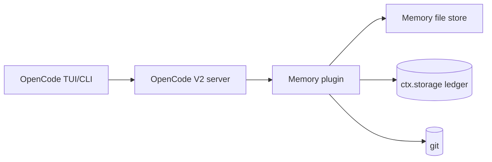

# C4 Level 2 — Containers / HLD: No-Fuss Memory Plugin for OpenCode V2

**Status:** proposed. **Sources:** Synthesized Report §4; V2 docs `/v2/docs/plugins/`, `/v2/docs/build/plugins/`, `/v2/docs/config/`.

## Containers (all local, single machine)

| Container | Role |
|---|---|
| OpenCode TUI/CLI | Developer surface; runs `/memory-review`, shows notices |
| OpenCode V2 server + plugin runtime | Loads plugin from `plugins` array or `.opencode/plugins/` auto-discovery; exposes `session.hook`, `event.subscribe`, `tool`/`command` transforms, `storage`, `vcs` |
| Memory file store | Six markdown files + `handoffs/` under `.opencode/memory/` (see `c4-05-data-model.md`) |
| Capture ledger | Durable JSON in `ctx.storage` (seen IDs, attempt timestamps) — restart-safe idempotency |
| Git repository | History, blame, restore; branch/status source for handoff snapshots |

## Topology and data flow

Single machine, zero network calls in the default path. Flow: prompt admission → INDEX attach (`prompt` hook) → work with failure-only capture (event stream → scratchpad) → brief + hint at bottom (`context` hook) → idle snapshot (`handoffs/`) → priors into summary (`compaction` hook) → human-approved promotion (`/memory-review`).

## Cross-cutting concerns

- **Budgets:** INDEX ≤30 lines, each file ≤60, auto-inject ≤~80 lines (~1.5k tokens). Overflow → `handoffs/`, never the prompt.
- **Cost/latency:** $0 default; file reads only.
- **Permissions:** `memory-manager` subagent edits scoped to `.opencode/memory/**`, shell denied; primary agents unchanged.
- **Security:** secrets blocklist, `<private>` redaction, per-project isolation, size caps before inject.
- **Config:** `plugins: ["./plugins/memory"]`, `agents: { memory-manager }`, `references: { memory }` (V2 config shapes; note: V2 `instructions` array is accepted but not resolved — memory rides `AGENTS.md`).
